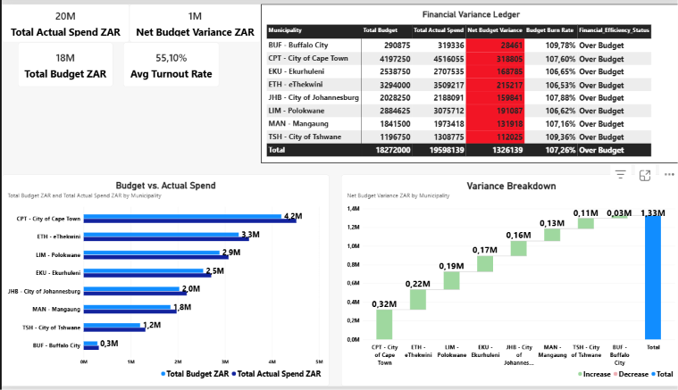
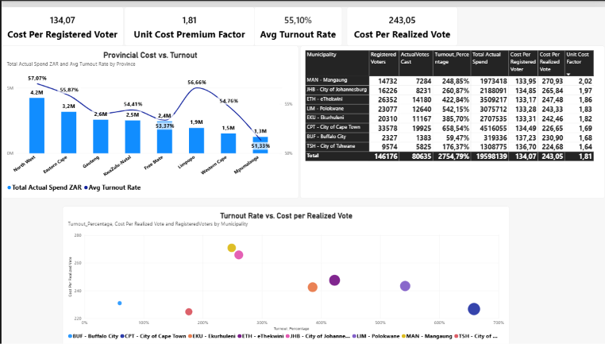
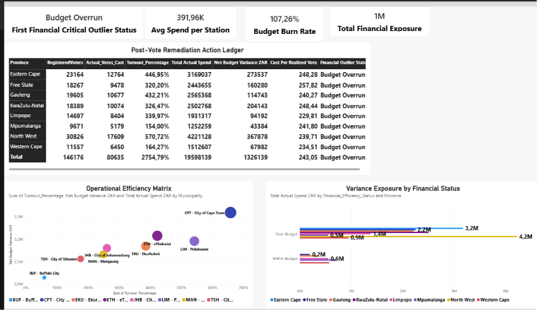

# 📊 Electoral Commission (IEC) — Post-Vote Financial & Operational Efficiency Analytics


## 📌 Executive Summary

This enterprise Power BI solution evaluates **post-election financial performance, expenditure variances, and unit-cost efficiency** across municipal voting districts. By linking budget execution directly to **voter turnout percentages**, the dashboard isolates operational inefficiencies where low voter turnout drove up the **cost per realized vote cast**.

### Key Business Insights:
* **Budget Variance Audit:** Direct identification of municipal districts operating with major overruns vs. cost savings.
* **Turnout Multiplier Effect:** Diagnostic analysis revealing how depressed turnout multiplies effective cost-per-vote metrics.
* **Risk Quadrant Classification:** Automated categorization of polling stations into priority remediation watchlists.

---

## 🖼️ Executive Dashboard Preview

### Page 1: Financial Execution & Budget Variance (FE&BV)
*Focuses on overall budget consumption (ZAR), net expenditure variance, and regional budget breakdown.*



---

### Page 2: Turnout Impact & Unit Cost Analysis (TI&UCA)
*Analyzes the relationship between voter turnout % and unit costs (Cost per Registered Voter vs. Cost per Realized Vote).*



---

### Page 3: Operational Efficiency & Risk Matrix (OE&RM)
*Synthesizes risk factors to flag critical review stations and guide post-election budget re-allocation.*



---

## 📐 Key Financial & Diagnostic DAX Formulas

### 1. Cost Per Realized Vote (Effective Unit Cost)
```dax
Cost Per Realized Vote = 
DIVIDE([Total Actual Spend ZAR], SUM(DF_OPS[Actual_Votes_Cast]), 0)
```

### 2. Unit Cost Premium Factor
```dax
Unit Cost Premium Factor = 
DIVIDE([Cost Per Realized Vote], [Cost Per Registered Voter], 0)
```

### 3. Total Financial Exposure (Cumulative Overruns)
```dax
Total Financial Exposure = 
CALCULATE(
    SUM('df_ops'[Budget_Variance_ZAR]),
    VALUE('df_ops'[Budget_Variance_ZAR]) > 0
)
```

### 4. Financial Outlier Status (Risk Categorization)
```dax
Financial Outlier Status = 
IF(
    DF_OPS[Budget_Variance_ZAR] > 0 && DF_OPS[Turnout_Percentage] < 0.50,
    "Critical Review Required",
    IF(
        DF_OPS[Budget_Variance_ZAR] > 0,
        "Budget Overrun",
        IF(DF_OPS[Turnout_Percentage] < 0.50, "Low Turnout Strain", "Optimal Execution")
    )
)
```

---

## 💡 Business Conclusion & Strategic Recommendations

1. **Fix Fixed-Resource Allocation:** Stations displaying high unit cost premiums were provisioned for 100% capacity despite turnout falling under 50%. Future operational budgeting must utilize dynamic staffing based on historical turnout trends.
2. **Targeted Remediation:** Stations flagged as `"Critical Review Required"` (High Overrun + Low Turnout) should undergo operational audits before resource allocation for upcoming election cycles.
3. **Data-Driven Budgeting:** Shifting from flat baseline budgeting to a **hybrid turnout-weighted unit cost model** will prevent multi-million ZAR budget leakages in future municipal elections.

---

## 🛠️ Data Pipeline & Architecture
* **ETL & Ingestion:** R / Python script extraction into Power Query.
* **Data Transformations:** Explicit decimal typing via DAX `VALUE()` dynamic handling.
* **Data Model:** Star Schema / Fact Table execution (`df_ops`).
